# Figure index

Figures in the catalogue’s [results folder](../../results/README.md).
Click a preview for the full-size PNG.

## Catalogue figures

| Figure | Description | Preview |
| --- | --- | --- |
| [Catalogue overview](../../results/v3/figures/v3_catalogue_growth_landscape.png) | Masses, redshifts, and objects with or without usable masses. |  |
| [Growth requirements by class](../../results/v3/figures/v3_class_aware_growth_pressure.png) | Required accretion rates and seed masses for each object class. |  |
| [Growth tracks](../../results/v3/figures/v3_all_object_growth_tracks.png) | Selected growth models compared with measured masses. |  |
| [Compatibility by class](../../results/v3/figures/v3_compatibility_summary.png) | Fraction of each class reached by each fixed growth model. |  |
| [Mass uncertainty summary](../../results/v3/figures/v3_monte_carlo_summary.png) | Required rates and the fraction of sampled masses requiring a rate above Eddington. |  |
| [Top 20 uncertainty-ranked objects](../../results/v3/figures/v3_uncertainty_robustness.png) | Required rates and reported-error intervals. |  |
| [Alternative mass estimates](../../results/v2/figures/v2_measurement_sensitivity.png) | How changing the adopted mass estimate changes the required rate. |  |

## Object maps

Each version’s visual-coverage table links to its maps. Identical accretion/seed
maps are stored once, in the earliest version; missing-mass reasons remain in
the table without placeholder PNGs.

| Figure | Description | Preview |
| --- | --- | --- |
| [Accretion rate versus seed mass](../../results/v2/parameter_maps/fedd_mass_maps/v2_fedd_mass_map_hza-capers-lrd-z9.png) | Six spin and merger cases. The white contour reaches the measured mass. | <a href="../../results/v2/parameter_maps/fedd_mass_maps/v2_fedd_mass_map_hza-capers-lrd-z9.png">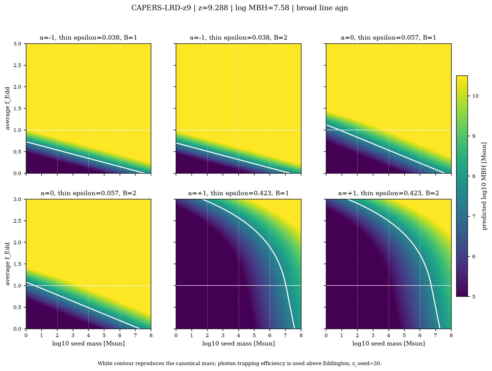</a> |
| [Starting redshift versus seed mass](../../results/v3/parameter_maps/seedredshift_mass_maps/v3_seedredshift_mass_map_hza-capers-lrd-z9.png) | Required average Eddington ratio for each seed mass and starting redshift. | <a href="../../results/v3/parameter_maps/seedredshift_mass_maps/v3_seedredshift_mass_map_hza-capers-lrd-z9.png">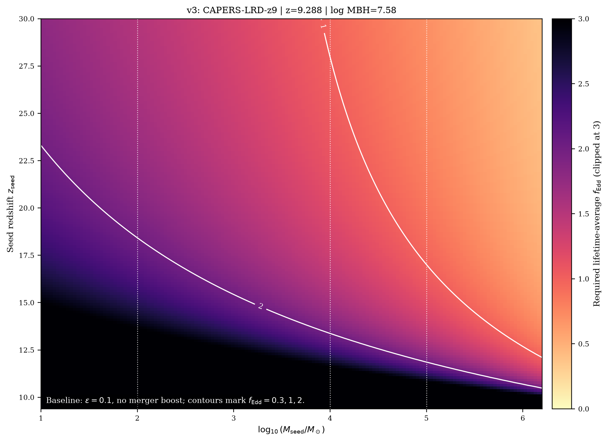</a> |

## Manuscript figures

| Figure | Description | Preview |
| --- | --- | --- |
| [Sample counts](../../results/for_manuscript/figures/landscape.png) | Primary, additional expanded, excluded, and missing-mass/error counts. | <a href="../../results/for_manuscript/figures/landscape.png">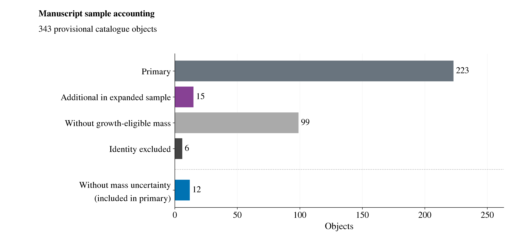</a> |
| [Growth tracks by efficiency](../../results/for_manuscript/figures/growth_tracks.png) | Selected tracks at four efficiencies. Bands span merger factors of 1–2. | <a href="../../results/for_manuscript/figures/growth_tracks.png">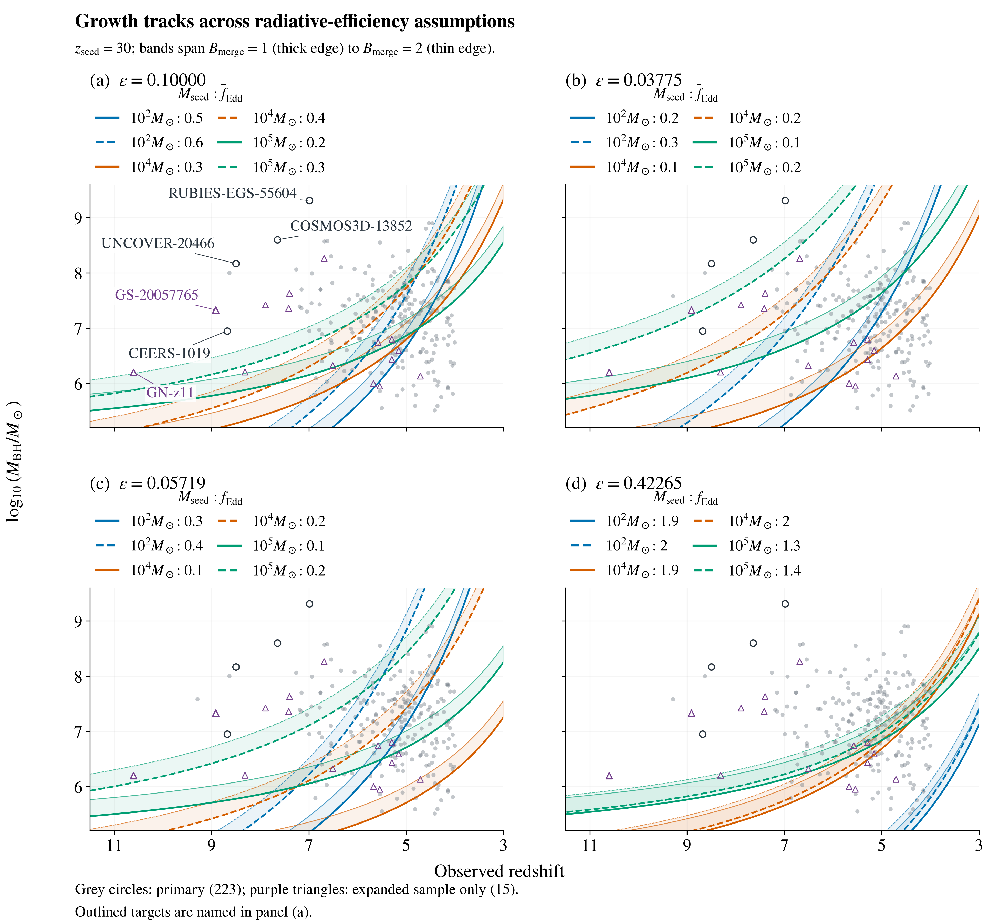</a> |
| [Uncertainty and mass shifts](../../results/for_manuscript/figures/uncertainty.png) | Primary objects above the reference rate threshold, before and after a −0.5 dex mass shift. | <a href="../../results/for_manuscript/figures/uncertainty.png">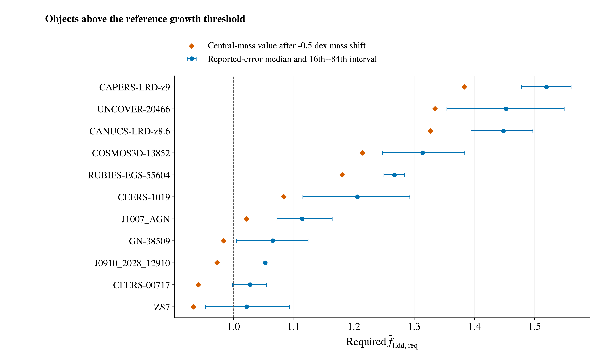</a> |
| [Seed mass and efficiency](../../results/for_manuscript/figures/growth_boundaries.png) | Maximum efficiency allowing an average Eddington ratio of at most one. | <a href="../../results/for_manuscript/figures/growth_boundaries.png">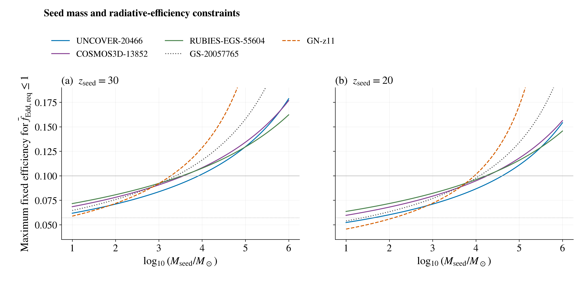</a> |
| [Sample compatibility](../../results/for_manuscript/figures/compatibility.png) | Primary and expanded samples under the same growth models. | <a href="../../results/for_manuscript/figures/compatibility.png">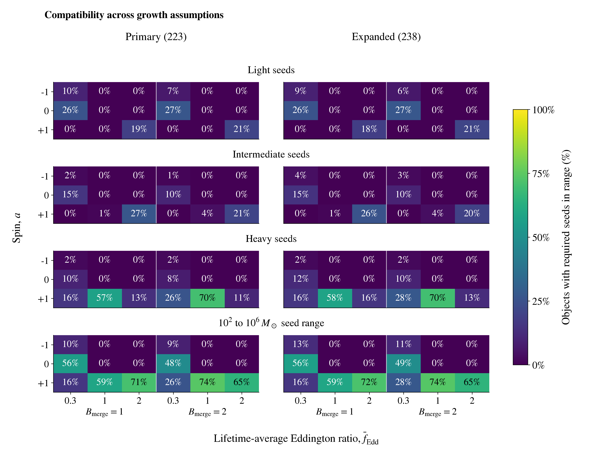</a> |
| [Alternative mass estimates](../../results/for_manuscript/figures/measurement_sensitivity.png) | Required rates from the preferred and alternative measurements. | <a href="../../results/for_manuscript/figures/measurement_sensitivity.png">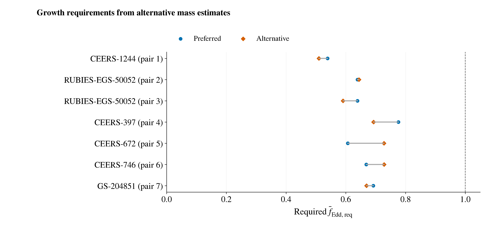</a> |
| [Starting time and seed mass](../../results/for_manuscript/figures/seed_timing_comparison.png) | Required rates for UNCOVER-20466 and GN-z11. | <a href="../../results/for_manuscript/figures/seed_timing_comparison.png">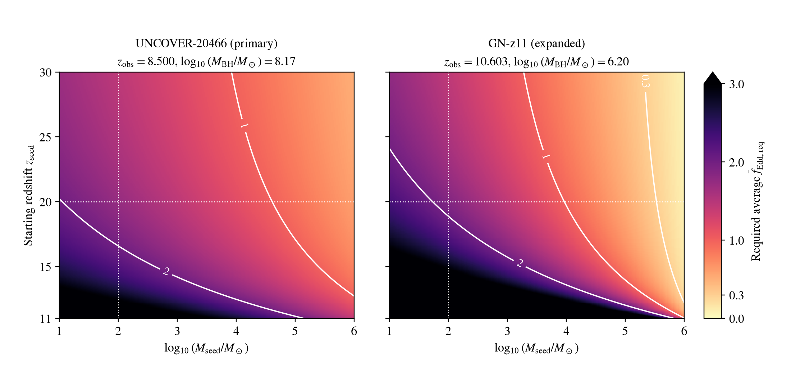</a> |
| [Earlier growth onset](../../results/for_manuscript/figures/early_start_comparison.png) | Growth starting at redshifts 30 and 3400, with radiation included. | <a href="../../results/for_manuscript/figures/early_start_comparison.png">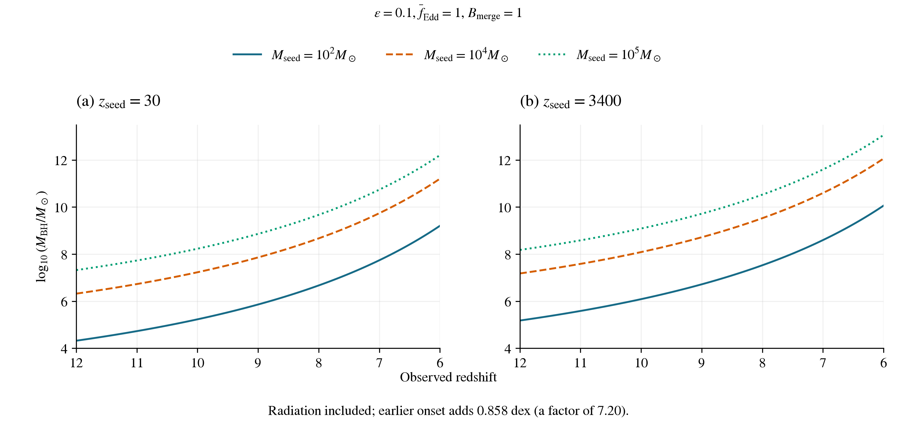</a> |

## v4: four-target growth study

| Figure | Description | Preview |
| --- | --- | --- |
| [Minimum seed masses](../../results/v4/figures/v4_minimum_seed_mass.png) | Minimum seed mass versus starting redshift, rate limit, and efficiency. | <a href="../../results/v4/figures/v4_minimum_seed_mass.png">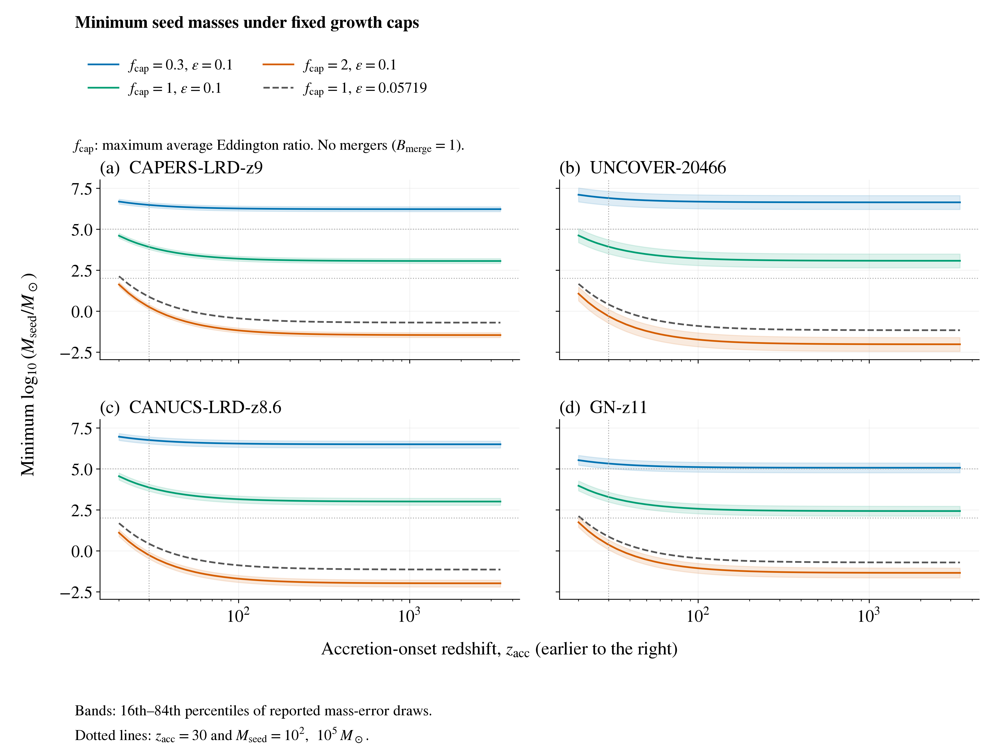</a> |
| [Starting time and seed mass](../../results/v4/figures/v4_seed_onset_maps.png) | Fraction of sampled masses reached within the allowed growth rate. | <a href="../../results/v4/figures/v4_seed_onset_maps.png">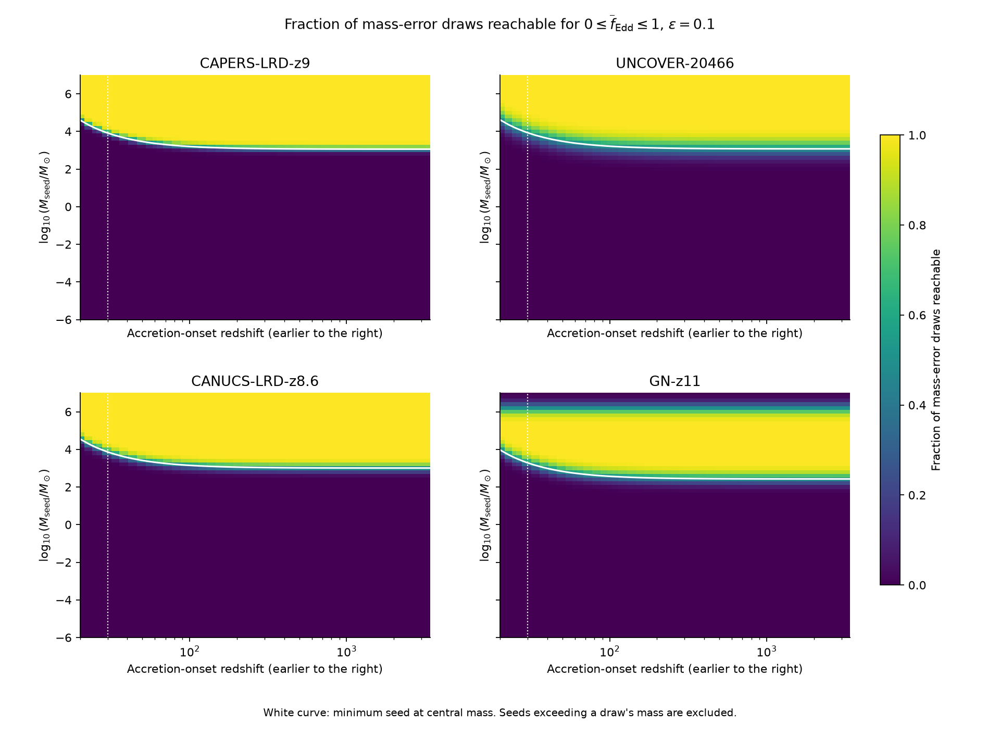</a> |
| [Selected growth models](../../results/v4/figures/v4_controls.png) | Required average rates for selected seed masses and starting times. | <a href="../../results/v4/figures/v4_controls.png">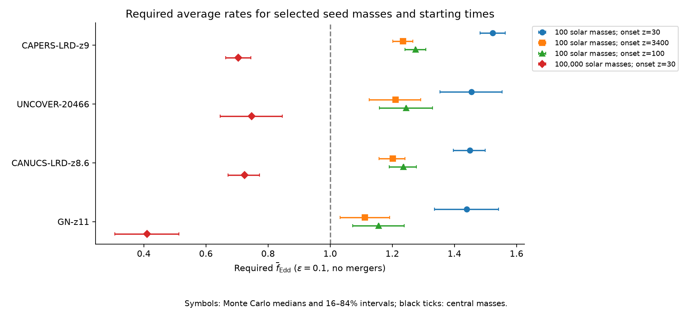</a> |
