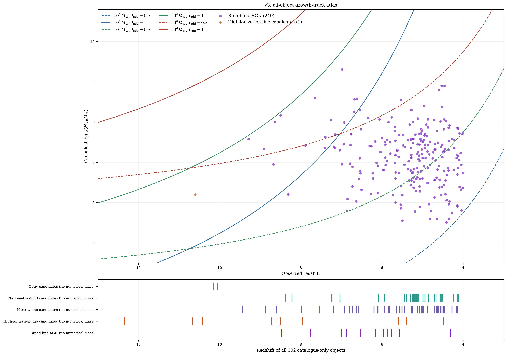
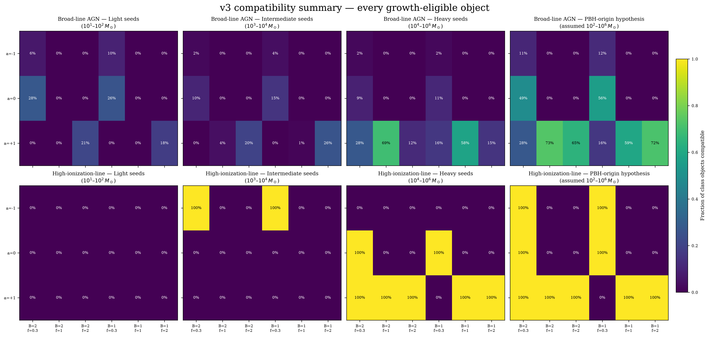
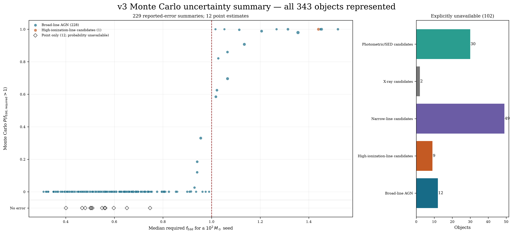
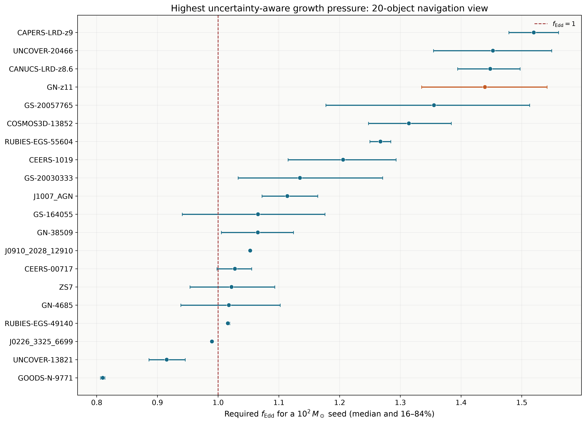
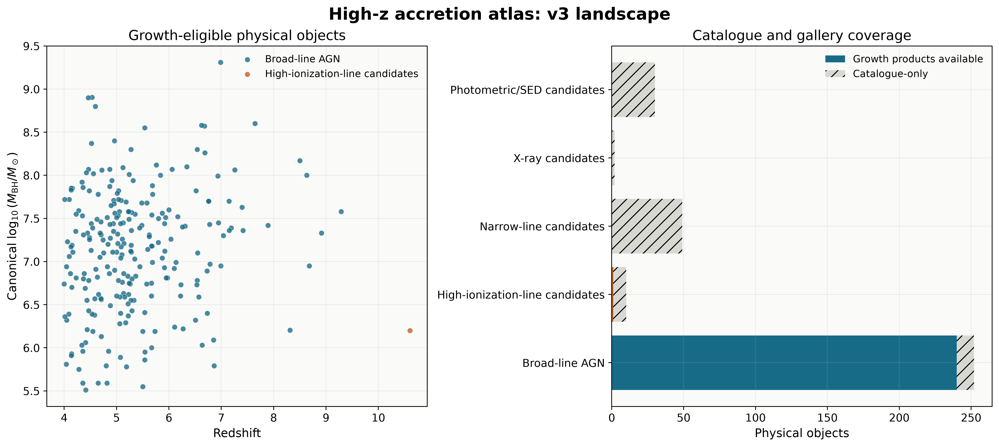
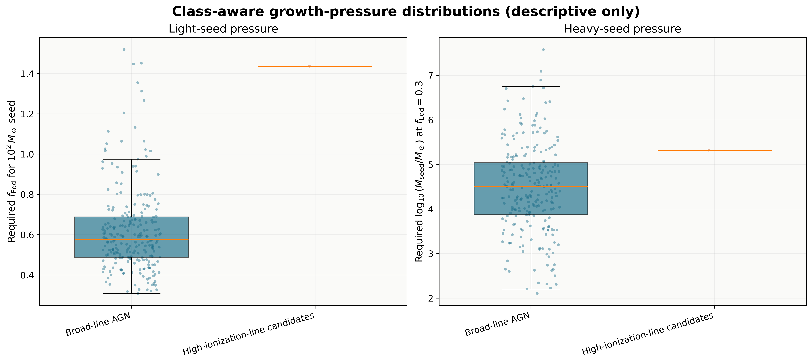
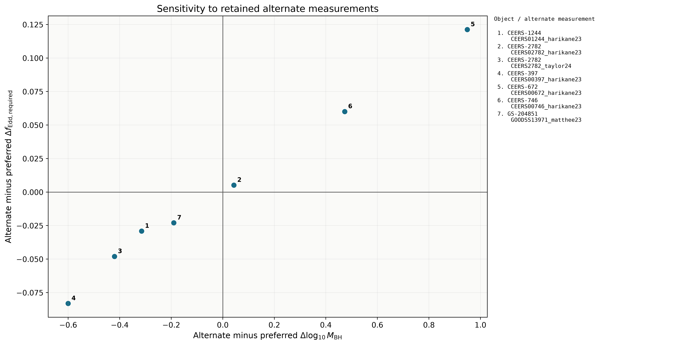

# Results

The catalogue’s growth calculations, rankings, uncertainty estimates, and
figures are stored here. Figures use PNG.

## Catalogue outputs

The full-catalogue outputs in `v1/`, `v2/`, and `v3/` share this structure:

```text
results/<version>/
├── figures/                    summary plots
├── tables/                     growth rates, uncertainties, rankings, and audits
└── parameter_maps/
    ├── fedd_mass_maps/          Eddington ratio versus seed mass
    └── seedredshift_mass_maps/  starting redshift versus seed mass
```

v1 and v2 have growth calculations for 23 and 215 objects. v3 has 241 objects
with usable masses and 102 without. The visual-coverage table links each usable
mass to both maps and records why other objects have no calculation. Unchanged
accretion/seed maps are stored once, in their earliest version. The v3 count remains
provisional because of [unresolved identities](../docs/source-notes/redshift-identity-audit.md).

| v3 table | Contents |
| --- | --- |
| [Object results](v3/tables/v3_object_results.csv) | Masses, errors, methods, sample flags, and growth requirements for all 343 objects. |
| [Assumption comparisons](v3/tables/v3_growth_assumption_comparison.csv) | Required rates under ten sets of assumptions for 241 usable masses. |
| [Field availability](v3/tables/v3_field_availability.csv) | Available and missing fields by source and object class. |
| [Minimum seed masses](v3/tables/v3_minimum_seed_mass.csv) | Starting-time, efficiency, rate-limit, and mass-shift tests for all 241 usable masses. |
| [Follow-up priorities](v3/tables/v3_followup_priority.csv) | Heuristic recommendations and ranks; unresolved identities require review and have no numerical follow-up score or rank. |

See [settings and column definitions](../docs/reference/catalogue-results.md).
`A_high_central_growth_requirement` describes central estimates and source
evidence, not robustness to calibration uncertainty. See the
[ranking policy](../docs/reference/science-policy.md#samples-identities-and-ranks).

## v3 figures

Files are in `v3/figures/`. See [all figure types and previews](../docs/reference/figures.md).

| Figure | Purpose | Preview |
| --- | --- | --- |
| `v3_all_object_growth_tracks.png` | Selected growth tracks and measured masses. | <a href="v3/figures/v3_all_object_growth_tracks.png"></a> |
| `v3_compatibility_summary.png` | Compatibility with fixed growth models. | <a href="v3/figures/v3_compatibility_summary.png"></a> |
| `v3_monte_carlo_summary.png` | Effects of reported mass errors. | <a href="v3/figures/v3_monte_carlo_summary.png"></a> |
| `v3_uncertainty_robustness.png` | Required rates and error intervals for twenty ranked objects. | <a href="v3/figures/v3_uncertainty_robustness.png"></a> |
| `v3_catalogue_growth_landscape.png` | Masses, redshifts, and mass availability. | <a href="v3/figures/v3_catalogue_growth_landscape.png"></a> |
| `v3_class_aware_growth_pressure.png` | Growth requirements by object class. | <a href="v3/figures/v3_class_aware_growth_pressure.png"></a> |
| `v2_measurement_sensitivity.png` | Alternative mass estimates; unchanged in v3 and shared from v2. | <a href="v2/figures/v2_measurement_sensitivity.png"></a> |

## Growth assumptions

All 72 compatibility checks per object remain in
[the compatibility table](v3/tables/v3_all_object_compatibility.csv).
The selected growth tracks above and [v4 figures](v4/README.md) show the comparisons
without the crowded 72-track variants.

## Selected samples and v4

- [Primary and expanded samples](v3/selected_samples/README.md): the 223-object primary and
  238-object expanded samples.
- [v4 growth tests](v4/README.md): minimum seed masses, starting-time tests,
  and required accretion rates for four v3 objects. Cosmic ages include radiation.

`results_inventory.csv` lists file sizes and hashes. See the
[reproduction guide](../docs/guides/reproducibility.md) for rebuild and verification commands.

## Scientific edition comparison

[Edition comparison](catalogue_edition_comparison.csv) records the effect of
the 17 October 2026 additions.
[Alternative mass estimates](v3/tables/v3_admission_source_model_sensitivity.csv)
compare CAPERS dust assumptions and J1007 masses with and without dust correction.
